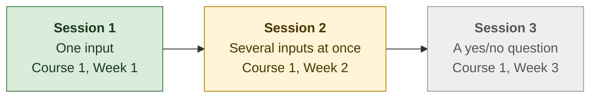
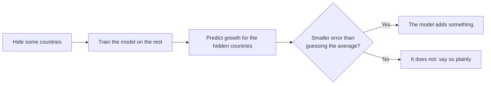

# Progress

*Last updated: 30 Oct 2026, after Session 1.*

**The question:** when an EU government tightens its budget, can a simple machine-learning model predict whether productivity growth suffers afterwards? And if it can, does that mean the tightening *caused* it?

**Where things stand:** 1 of 3 planned sessions is done. The model finds a real effect, but it predicts barely better than guessing the average. So far, machine learning adds nothing beyond the econometrics in my thesis.

## Roadmap

Each session applies one week of Andrew Ng's [Machine Learning Specialization](https://www.coursera.org/specializations/machine-learning-introduction) to my thesis data.

Green = done, yellow = next, grey = later.

## How I test every model

Every model is judged the same way, so the results can be compared:

I split the data **by country**, never by random rows. The growth figures overlap in time (each covers several years), so a random split would let the model peek at the answer.

## Results so far

| Session | Model | Better than guessing the average (unseen countries) | Beat the guess in hidden-country tests | TFP change after an average consolidation |
|---|---|---|---|---|
| 1 | Straight line, one input | 1.2 % | 13 of 26 (a coin flip) | — |
| 1 | Straight line with country and year effects | — | — | −0.89 % |
| Benchmark | My thesis (local projection) | — | — | −1.50 % |

**What this means in plain words:** countries that tighten their budgets do see lower productivity growth afterwards. The effect is statistically significant, but it is small compared with everything else that moves growth, so it cannot forecast what will happen in any one country. A straight line also spreads the effect thinly, which is why it comes out smaller than in my thesis.

## What each session taught me

| Session | What I did | What I learned |
|---|---|---|
| 1 ([notebook](notebooks/ML01_dCAPB_to_TFP_linear_regression.ipynb), [log](notes/session01_log.md)) | Drew the best straight line from the size of a budget tightening (ΔCAPB) to TFP growth over the next two years, and tested it on countries the model had never seen. | The effect is real but barely better than guessing as a predictor. **Significant is not the same as predictive.** |
| 2 | *Next:* add the four control variables from the thesis and a yes/no "consolidation episode" flag, and put all inputs on the same scale. | |
| 3 | *Later:* predict a yes/no outcome: is a consolidation followed by below-median TFP growth? | |

## Words used here

- **TFP (total factor productivity):** how much output an economy gets from its workers and machines together.
- **Consolidation (ΔCAPB):** a government tightening its budget, measured as the change in the cyclically adjusted primary balance, in % of GDP. An *episode* is a tightening of at least 1.5 % of GDP in one year.
- **Guessing the average (baseline):** predicting the same average growth for every country. A model is only useful if it beats this.
- **Unseen countries:** countries kept out while the model learns, then used to test it.
- **Error:** the average squared gap between predicted and actual growth. Smaller is better.
- **Country and year effects (fixed effects):** comparing each country with itself over time, and removing shocks that hit all countries in the same year.

The numbers in this file come from [`progress/`](progress/), which also feeds my private progress dashboard. Both are updated after every session.
