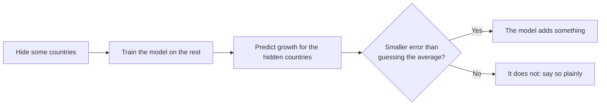

# Progress

*Last updated: 2 Nov 2026, after Session 2.*

**The question:** when an EU government tightens its budget, can a simple machine-learning model predict whether productivity growth suffers afterwards? And if it can, does that mean the tightening *caused* it?

**Where things stand:** 2 of 3 planned sessions are done. The effect estimate is now close to my thesis, but the model still does not reliably predict better than guessing the average. So far, machine learning adds nothing reliable beyond the econometrics in my thesis.

## Roadmap

Each session applies one week of Andrew Ng's [Machine Learning Specialization](https://www.coursera.org/specializations/machine-learning-introduction) to my thesis data.

Green = done, yellow = next, grey = later.

## How I test every model

Every model is judged the same way, so the results can be compared:

I split the data **by country**, never by random rows. The growth figures overlap in time (each covers several years), so a random split would let the model peek at the answer.

## Results so far

### Can it predict?

"Six hidden" uses the same six countries as Session 1. "Each hidden in turn" hides all 26 countries one at a time. **Overall** adds up all their errors, so large misses count in full.

| Session | Model | Six hidden: better than guessing | Each hidden in turn: wins | Each hidden in turn: overall |
|---|---|---|---|---|
| 1 | ΔCAPB only | 1.2 % | 13 of 26 | +0.4 % |
| 1 | ΔCAPB only, on Session 2's rows | 1.1 % | 15 of 26 | +0.5 % |
| 2 | Controls only, no ΔCAPB | 9.3 % | 17 of 26 | −1.1 % |
| **2** | **ΔCAPB + controls + flag** | **10.0 %** | **16 of 26** | **−1.1 %** |
| 2 | Same, plus ΔCAPB² | 9.8 % | 16 of 26 | −1.6 % |

**In plain words:** the 10 % looks like a big jump, but it is mostly a lucky choice of hidden countries. Across 500 random sets of six countries, the typical gain is only 1.6 %, and the model beats the guess just 54 % of the time. It helps a lot in some countries (Belgium, Italy) and hurts a lot in others (Luxembourg, Denmark, Ireland). The controls do most of the work, and knowing the size of the budget tightening adds almost nothing to the forecast.

### How big is the effect?

Estimated change in TFP two years after an average consolidation, comparing each country with itself over time.

| Session | Model | TFP change |
|---|---|---|
| 1 | ΔCAPB only | −0.89 % |
| 2 | ΔCAPB + controls + flag | −1.36 % |
| 2 | Same, plus ΔCAPB² | −1.46 % |
| 2 | Flag + controls (the thesis design) | −1.49 % |
| Benchmark | My thesis (local projection) | −1.50 % |

**In plain words:** with the controls and the flag, the estimate moves close to my thesis. A better estimate of an effect is not the same as a better forecast.

### Does ΔCAPB² catch the threshold?

Only partly, and it does not help prediction. Within the data it fits better, but much of that comes from Ireland's 2010–11 bank-rescue years. A squared term also says a big loosening hurts as much as a big tightening, while the actual averages stay flat for loosening and fall sharply only from about 3 pp of tightening.

### A data problem to check

Trade openness looks far too low in five non-euro countries (Sweden about 8 % of GDP, Hungary about 0.4 %). Inflation also looks off in some non-euro countries (Poland 2009: −16.5 %). A currency mismatch would fit this pattern, but I have not confirmed the cause or changed the data. Leaving out both controls barely moves the effect estimate (thesis design: −1.48 %). In the each-hidden-in-turn test, the Session 2 model goes from −1.1 % to +2.7 % overall, a warning about the data rather than a better model.

## What each session taught me

| Session | What I did | What I learned |
|---|---|---|
| 1 ([notebook](notebooks/ML01_dCAPB_to_TFP_linear_regression.ipynb), [log](notes/session01_log.md)) | Drew the best straight line from the size of a budget tightening (ΔCAPB) to TFP growth over the next two years, and tested it on countries the model had never seen. | The effect is real but barely better than guessing as a predictor. **Significant is not the same as predictive.** |
| 2 ([notebook](notebooks/ML02_multiple_inputs_vectorized_gradient_descent.ipynb), [log](notes/session02_log.md)) | Added the four thesis controls and a yes/no consolidation flag, scaled the inputs using the training countries only, and trained with vectorized gradient descent. | The effect moved close to the thesis, but prediction did not reliably improve. **One test can flatter a model.** |
| 3 | *Next:* predict a yes/no outcome: is a consolidation followed by below-median TFP growth? | |

## Words used here

- **TFP (total factor productivity):** how much output an economy gets from its workers and machines together.
- **Consolidation (ΔCAPB):** a government tightening its budget, measured as the change in the cyclically adjusted primary balance, in % of GDP. An *episode* is a tightening of at least 1.5 % of GDP in one year.
- **Guessing the average (baseline):** predicting the same average growth for every country. A model is only useful if it beats this.
- **Unseen countries:** countries kept out while the model learns, then used to test it.
- **Error:** the average squared gap between predicted and actual growth. Smaller is better.
- **Country and year effects (fixed effects):** comparing each country with itself over time, and removing shocks that hit all countries in the same year.
- **Controls:** other things that affect growth, held in the model so they are not mistaken for the budget effect. Here: GDP growth, debt, inflation and trade openness, each from the year before.
- **Scaling (z-score):** putting every input on a similar scale by subtracting its average and dividing by its spread. The average and spread come from the training countries only, so nothing leaks from the hidden ones.
- **Learning rate (α):** how big a step the model takes each time it adjusts. Too small is slow; too big blows up.
- **Vectorized:** calculating all rows and inputs in one step, instead of looping through them one at a time.
- **Learning curve:** a chart of the model's error during training. It should fall, then go flat.

The numbers in this file come from [`progress/`](progress/), which also feeds my private progress dashboard. Both are updated after every session.
