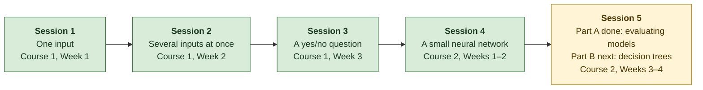
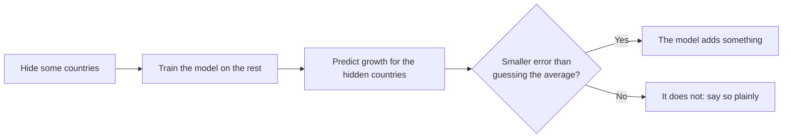

# Progress

*Last updated: 10 Nov 2026, after Session 5 Part A (evaluating models).*

**The question:** when an EU government tightens its budget, can a simple machine-learning model predict whether productivity growth suffers afterwards? And if it can, does that mean the tightening *caused* it?

**Where things stand:** Course 1 is finished, and so are Course 2 Weeks 1–2 and the first half of Week 3 (evaluating models). Four sessions are done, and the first half of Session 5 (evaluating models); decision trees come next. The effect estimate is close to my thesis, and a data error in two controls was found and fixed along the way. Predicting a number never beat guessing the average. A yes/no model of which consolidations are followed by weak growth does not beat the simple guess either, once a leak in my code is fixed. A placebo test finds a faint pattern in the real consolidation years, far too weak to predict with. A small neural network does no better: it only looked good on one lucky split with one lucky random seed. Checking the models the Week 3 way shows they all settle at the level of the simple guess as data is added, and more flexible models only fit noise. Taking the log of trade openness, so that Luxembourg is no longer an extreme outlier, gives the first small win in all three tests, which still needs a placebo check. So far, machine learning adds nothing reliable beyond the econometrics in my thesis.

## Roadmap

Each session applies one week of Andrew Ng's [Machine Learning Specialization](https://www.coursera.org/specializations/machine-learning-introduction) to my thesis data.

Green = done, yellow = next, grey = later.

## How I test every model

Every model is judged the same way, so the results can be compared:

I split the data **by country**, never by random rows. The growth figures overlap in time (each covers several years), so a random split would let the model peek at the answer.

## Results so far

### Can it predict?

"Six hidden" uses the same six countries as Session 1. "Each hidden in turn" hides all 26 countries one at a time. **Overall** adds up all their errors, so large misses count in full.

| Session | Model | Six hidden: better than guessing | Each hidden in turn: wins | Each hidden in turn: overall |
|---|---|---|---|---|
| 1 | ΔCAPB only | 1.2 % | 13 of 26 | +0.4 % |
| 1 | ΔCAPB only, on Session 2's rows | 1.1 % | 15 of 26 | +0.5 % |
| 2 | Controls only, no ΔCAPB | 7.9 % | 13 of 26 | −46.7 % |
| **2** | **ΔCAPB + controls + flag** | **8.6 %** | **13 of 26** | **−48.7 %** |
| 2 | Same, plus ΔCAPB² | 8.5 % | 13 of 26 | −49.3 % |
| 2 | Same, inflation capped at ±30 % | 7.1 % | 14 of 26 | −7.4 % |
| 2 | Same, before the data correction | 10.0 % | 16 of 26 | −1.1 % |

**In plain words:** the 8.6 % looks like a jump, but it is a lucky choice of hidden countries. Across 500 random sets of six countries, the typical result is 7.2 % *worse* than guessing, and the model beats the guess just 38 % of the time. The very large −48.7 % comes mostly from Bulgaria, whose 1997 hyperinflation (about 1,040 %) is far outside what the model saw in training. Even without that extreme, the model still loses to the simple guess overall.

### How big is the effect?

Estimated change in TFP two years after an average consolidation, comparing each country with itself over time.

| Session | Model | TFP change |
|---|---|---|
| 1 | ΔCAPB only | −0.89 % |
| 2 | ΔCAPB + controls + flag | −1.38 % |
| 2 | Same, plus ΔCAPB² | −1.49 % |
| 2 | Flag + controls (the thesis design) | −1.52 % |
| Benchmark | My thesis (local projection) | −1.50 % |

**In plain words:** with the controls and the flag, the estimate moves close to my thesis. A better estimate of an effect is not the same as a better forecast.

### Does ΔCAPB² catch the threshold?

Only partly, and it does not help prediction. Within the data it fits better, but much of that comes from Ireland's 2010–11 bank-rescue years. A squared term also says a big loosening hurts as much as a big tightening, while the actual averages stay flat for loosening and fall sharply only from about 3 pp of tightening.

### Session 3: can it tell which consolidations are followed by weak growth?

A yes/no version of the question. Out of the 96 consolidation episodes, which ones were followed by TFP growth below the median? The simple guess here is "always predict the most common answer". **Log loss** scores how confident the model was in the right answer: lower is better, and confident mistakes cost a lot.

**A correction (9 Nov 2026).** My first version had a leak: when the code chose how strongly to regularize (λ), it also peeked at the hidden countries. That made the model look better than the simple guess. With the leak fixed, it is not. The numbers below are the corrected ones.

| Model | Six hidden: log loss vs guess | Six hidden: accuracy vs guess | Each hidden in turn: log loss vs guess | Each hidden in turn: accuracy vs guess |
|---|---|---|---|---|
| **ΔCAPB + controls** | **0.695 vs 0.710** | **40 % vs 40 %** | **0.730 vs 0.694** | **64 % vs 49 %** |
| ΔCAPB only | 0.696 vs 0.710 | 40 % vs 40 % | 0.685 vs 0.694 | 57 % vs 49 % |
| Controls only | 0.698 vs 0.710 | 40 % vs 40 % | 0.734 vs 0.694 | 64 % vs 49 % |

**In plain words:** on the six hidden countries the model makes exactly the same yes/no calls as the simple guess. With every country taking a turn, its log loss is *worse* than the guess. That comes down to one country: in Luxembourg's turn the model chose a weaker penalty and was badly wrong. Without that one turn it is slightly better than the guess, but by too little to be useful. Its accuracy looks better, but this guess is wrong more than half the time, so that is an easy bar. Part of any signal is also timing: episodes in the 2008–2013 crisis years were followed by weak growth much more often (64 %) than earlier ones (41 %).

**Taking the timing out.** I then compared each episode with the other countries in the *same year* instead of with all years. A crisis year then no longer counts as "weak" just because everyone was doing badly.

| Test | Compared with all years | Compared with the same year |
|---|---|---|
| Six hidden: log loss vs guess | 0.695 vs 0.710 | 0.704 vs 0.718 |
| Six hidden: accuracy vs guess | 40 % vs 40 % | 40 % vs 40 % |
| Each hidden in turn: log loss vs guess | 0.730 vs 0.694 | 0.717 vs 0.700 |
| Each hidden in turn: accuracy vs guess | 64 % vs 49 % | 55 % vs 43 % |
| Countries where it beats the guess | 17 of 24 | 13 of 24 |
| 500 random splits: beats the guess on log loss | 76 % of splits | 72 % of splits |

**In plain words:** with or without the timing, the model is no better than the guess when every country takes a turn. In random splits it often wins, but by very little (a median of about 1–2 %).

**Does growth before predict growth after?** My thesis found that consolidating countries were already falling behind before they tightened (a *pre-trend*). So I added one input: TFP growth in the two years before the episode, compared with other countries in the same year. The panel starts in 1995, so the five 1997 episodes have no "before" and are left out (91 remain). All three models below use the same 91.

| Test | Without the pre-trend | Pre-trend only | Both together |
|---|---|---|---|
| Six hidden: log loss vs guess | 0.689 vs 0.702 | 0.678 vs 0.702 | 0.658 vs 0.702 |
| Each hidden in turn: log loss vs guess | 0.722 vs 0.700 | 0.697 vs 0.700 | 0.717 vs 0.700 |
| Each hidden in turn: accuracy vs guess | 54 % vs 48 % | 52 % vs 48 % | 51 % vs 48 % |
| Countries where it beats the guess | 11 of 24 | 15 of 24 | 12 of 24 |
| 500 random splits: beats the guess on log loss | 55 % of splits | 77 % of splits | 41 % of splits |

**In plain words:** growth before an episode carries a faint signal: countries that were growing faster before were less often weak after. On its own it is the only model that does not lose to the guess when every country takes a turn, but only just. Adding it to the other inputs does not help.

**Placebo test: do the real consolidation years matter?** If the model has learned something about consolidations, it should do better on the real episodes than on fake ones. So I shuffled, within each country, which years count as consolidations (keeping how many each country had and how big they were), 500 times, and reran the model on each fake version.

| | Compared with all years | Compared with the same year |
|---|---|---|
| Real episodes: log loss vs guess | +0.9 % | +1.4 % |
| Fake versions doing at least as well (log loss) | 21 % | 8 % |
| Real episodes: accuracy vs guess | +14.5 points | +12.5 points |
| Fake versions doing at least as well (accuracy) | 2 % | 3 % |

**In plain words:** on how *confident* it is (log loss), the model is not unusual: plenty of fake versions do as well. On how often its yes/no calls are *right* (accuracy), only 2–3 % of fake versions match the real episodes. So the real consolidation years carry a faint pattern that random years do not. But it is far too weak to predict with: the model is barely more confident than a coin. And it is not cause: countries choose when to consolidate, and they were already diverging before.

### Session 4: does a small neural network do better?

The same yes/no question as Session 3, now with a tiny neural network: one hidden layer of 2, 4 or 8 units. Its size and how strongly it is held back (λ) were chosen on the training countries only, and logistic regression was run side by side in the same tests.

| Test | Logistic regression | Neural network | Logistic regression, same year | Neural network, same year |
|---|---|---|---|---|
| Six hidden: log loss vs guess | 0.695 vs 0.710 | 0.705 vs 0.710 | 0.704 vs 0.718 | 0.639 vs 0.718 |
| Six hidden: accuracy vs guess | 40 % vs 40 % | 40 % vs 40 % | 40 % vs 40 % | 72 % vs 40 % |
| Each hidden in turn: log loss vs guess | 0.730 vs 0.694 | 0.763 vs 0.694 | 0.726 vs 0.700 | 0.713 vs 0.700 |
| Countries where it beats the guess | 17 of 24 | 14 of 24 | 13 of 24 | 12 of 24 |
| 500 random splits: beats the guess on log loss | 76 % of splits | 71 % of splits | 72 % of splits | 49 % of splits |

**In plain words:** no. When every country takes a turn, the network is worse than the simple guess, and no better than logistic regression. It looks impressive once, on the six hidden countries with the "same year" target (72 % right). But that was one random starting point (seed): with four other seeds the same test gives a log loss anywhere from 0.66 to 0.75, and in random splits it wins only half the time. Even the smallest network here has about one adjustable number for every five training episodes, and the largest almost one per episode. More flexibility adds parameters, not information. A three-way version (weak / middle / strong growth) does not beat the guess either.

### Session 5, Part A: why don't the models beat the guess?

Week 3 of Course 2 gives tools to tell *why* a model falls short. The idea: compare the error on the countries a model learned from (**J_train**) with the error on countries held back to choose settings (**J_cv**), against the simple guess.

- **Too flexible (high variance):** J_train is low but J_cv is high. The model memorises the training countries. That is what happens here with lots of polynomial features and little regularization: a degree-3 model scores 0.12 on its own training countries and 2.9 on others (the simple guess scores about 0.70).
- **Held back enough:** J_train and J_cv both settle at about the simple guess. A slightly curved (degree-2) model dips a little below it in cross-validation, and is the best model found here.
- **Would more data help? (learning curves)** As training countries are added, the held-back models' two errors close in on the simple guess from both sides. More data makes them *as good as* the guess, not better. The flexible model would need far more countries than the EU has.

**In plain words:** the models are not too simple, and they are not just short of data. These inputs seem to carry very little information about productivity growth over the next few years.

When the best model from this step (degree 2) went through the usual tests, it beat the guess in 69–77 % of random splits, by a median of about 3 %. That is the most frequent small gain so far. But with every country taking a turn it is still worse overall (−32 % and −1 %), and again almost all of that comes from Luxembourg: in its turn the model picked a much more flexible setting and was badly wrong. A lead to check, not a usable predictor.

**The placebo check.** As in Session 3, I shuffled which years count as consolidations within each country, many times, and reran this model. On how confident it is (log loss), the real episodes are not unusual: 10–15 % of the fake versions do as well. On how often its yes/no calls are right, one version stands out (only 2 % of fake versions match it), the same faint pattern Session 3 found. So the small gain is not about consolidations. Luxembourg goes wrong because it trades far more than any other country (240–376 % of GDP, against about 110 % for a typical episode), so when it is hidden the model has to guess far outside anything it has seen. Removing Luxembourg would choose the data to fit the result; a rule for every country (for example using the log of trade openness) is the better fix.

**Trying that rule.** Using the log of trade openness for every country (decided before running, Luxembourg kept) pulls Luxembourg much closer to the others. Its bad turn now costs about 7 points instead of 39, and for the first time a model beats the simple guess in all three tests: by about 2 % when every country takes a turn, and in 84 % and 64 % of random splits. That is small, and I chose the rule after seeing the problem, so luck is possible. The fake-years check has not been run on this version yet. Promising, not yet a finding.

### A data error, found and fixed

Two thesis controls were built from mismatched series: trade openness mixed currencies and price bases (Sweden showed about 8 % of GDP; it is about 84 %), and inflation counted exchange-rate moves as price changes (Poland 2009 showed −16.5 %; it was +2.9 %). The panel here is now corrected. Re-running my thesis code on it leaves the main findings in place: TFP at two years moves from −1.50 % to −1.53 %. Details are in [the correction note](notes/controls_correction.md).

## What each session taught me

| Session | What I did | What I learned |
|---|---|---|
| 1 ([notebook](notebooks/ML01_dCAPB_to_TFP_linear_regression.ipynb), [log](notes/session01_log.md)) | Drew the best straight line from the size of a budget tightening (ΔCAPB) to TFP growth over the next two years, and tested it on countries the model had never seen. | The effect is real but barely better than guessing as a predictor. **Significant is not the same as predictive.** |
| 2 ([notebook](notebooks/ML02_multiple_inputs_vectorized_gradient_descent.ipynb), [log](notes/session02_log.md)) | Added the four thesis controls and a yes/no consolidation flag, scaled the inputs using the training countries only, and trained with vectorized gradient descent. | The effect moved close to the thesis, but prediction did not improve. **One test can flatter a model.** Checking the inputs also exposed a real data error. |
| 3 ([notebook](notebooks/ML03_logistic_regression_episode_classifier.ipynb), [log](notes/session03_log.md)) | Predicted a yes/no answer (below-median TFP growth after a consolidation) with logistic regression, tried several regularization strengths, and repeated the unseen-country tests. | No gain over the simple guess once a leak in how λ was chosen is fixed. A placebo test finds a faint pattern in the real consolidation years, too weak to predict with. **Leakage can hide in the tuning step, and a model can predict for the wrong reason.** |
| 4 ([notebook](notebooks/ML04_neural_network_episode_classifier.ipynb), [log](notes/session04_log.md)) | Trained a tiny neural network on the same yes/no question, chose its size and λ on the training countries only, compared it with logistic regression, and checked how much the random seed matters. | No gain: worse than the simple guess when every country takes a turn. One good seed on one split was luck. **On little data, a more flexible model adds parameters, not information.** |
| 5a ([notebook](notebooks/ML05a_evaluating_models_bias_variance.ipynb), [log](notes/session05_log.md)) | Compared errors on training and held-back countries for simple and curved logistic regression, drew learning curves, and ran the cross-validation choice through the usual tests. | The models settle at the simple guess as data is added; more flexibility only fits noise. **The limit is the information in the data, not the model.** |
| 3b ([practice notebook](notebooks/ML03b_logistic_regression_practice.ipynb)) | Exercises to write the sigmoid, cost, gradient and gradient descent myself, draw a decision boundary, and watch a wiggly curve overfit, each checked against scikit-learn. | Done: see my completed version below. |
| 3b, completed ([notebook](notebooks/ML03b_logistic_regression_practice_completed.ipynb)) | My own answers to the three practice exercises. | All 25 checks pass against scikit-learn. |

## Words used here

- **TFP (total factor productivity):** how much output an economy gets from its workers and machines together.
- **Consolidation (ΔCAPB):** a government tightening its budget, measured as the change in the cyclically adjusted primary balance, in % of GDP. An *episode* is a tightening of at least 1.5 % of GDP in one year.
- **Guessing the average (baseline):** predicting the same average growth for every country. A model is only useful if it beats this.
- **Unseen countries:** countries kept out while the model learns, then used to test it.
- **Error:** the average squared gap between predicted and actual growth. Smaller is better.
- **Country and year effects (fixed effects):** comparing each country with itself over time, and removing shocks that hit all countries in the same year.
- **Controls:** other things that affect growth, held in the model so they are not mistaken for the budget effect. Here: GDP growth, debt, inflation and trade openness, each from the year before.
- **Scaling (z-score):** putting every input on a similar scale by subtracting its average and dividing by its spread. The average and spread come from the training countries only, so nothing leaks from the hidden ones.
- **Learning rate (α):** how big a step the model takes each time it adjusts. Too small is slow; too big blows up.
- **Vectorized:** calculating all rows and inputs in one step, instead of looping through them one at a time.
- **Logistic regression:** a model that gives a probability (here, the chance of weak growth) instead of a number.
- **Log loss:** a score for probability predictions. Lower is better, and being confidently wrong costs the most.
- **Regularization (λ):** a penalty that keeps the model's weights small, so it does not fit noise in a small sample.
- **Placebo test:** rerunning the analysis on fake data where the thing you care about (here, which years were consolidations) is shuffled at random. If the real result looks like the fake ones, it is probably not about that thing.
- **Leak (leakage):** information from the test countries slipping into training or tuning, which makes a model look better than it is.
- **Neural network:** a model built from layers of small units. Each unit takes a weighted sum of its inputs; a *ReLU* unit then keeps it if positive and gives 0 otherwise. Stacking units lets the model draw curved boundaries.
- **Parameters:** the numbers a model adjusts while learning (weights and biases). Many parameters and few rows make it easy to fit noise.
- **Adam:** a version of gradient descent that adjusts the step size for each parameter by itself.
- **Random seed:** the starting point for the random numbers, such as a network's first weights. Fixing it makes a run repeatable; changing it shows how much luck is involved.
- **Training / cross-validation / test set:** countries the model learns from; countries held back to choose its settings; countries held back to report the final result (used once, at the end).
- **J_train and J_cv:** the error on the training countries and on the cross-validation countries.
- **High bias / high variance:** a model too simple to fit even its training data (high bias), or one that fits its training data but not new data (high variance).
- **Pre-trend:** how a country was already doing before the budget tightening. If it was already falling behind, a later slowdown is not all caused by the tightening.
- **Learning curve:** two kinds. In Course 1, a chart of the model's error during training: it should fall, then go flat. In Course 2 Week 3, a chart of J_train and J_cv as the amount of training data grows: it shows whether more data would help.

The numbers in this file come from [`progress/`](progress/), which also feeds my private progress dashboard. Both are updated after every session.
