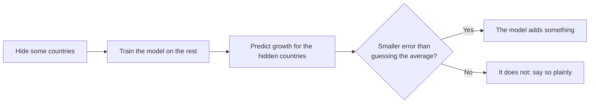

# Progress

*Last updated: 5 Nov 2026, after Session 3.*

**The question:** when an EU government tightens its budget, can a simple machine-learning model predict whether productivity growth suffers afterwards? And if it can, does that mean the tightening *caused* it?

**Where things stand:** all 3 planned sessions are done. The effect estimate is close to my thesis, and a data error in two controls was found and fixed along the way. Predicting a number never beat guessing the average. A yes/no model of which consolidations are followed by weak growth does slightly better than the simple guess, but partly because it recognises the crisis years. So far, machine learning adds nothing reliable beyond the econometrics in my thesis.

## Roadmap

Each session applies one week of Andrew Ng's [Machine Learning Specialization](https://www.coursera.org/specializations/machine-learning-introduction) to my thesis data.

Green = done, yellow = next, grey = later.

## How I test every model

Every model is judged the same way, so the results can be compared:

I split the data **by country**, never by random rows. The growth figures overlap in time (each covers several years), so a random split would let the model peek at the answer.

## Results so far

### Can it predict?

"Six hidden" uses the same six countries as Session 1. "Each hidden in turn" hides all 26 countries one at a time. **Overall** adds up all their errors, so large misses count in full.

| Session | Model | Six hidden: better than guessing | Each hidden in turn: wins | Each hidden in turn: overall |
|---|---|---|---|---|
| 1 | ΔCAPB only | 1.2 % | 13 of 26 | +0.4 % |
| 1 | ΔCAPB only, on Session 2's rows | 1.1 % | 15 of 26 | +0.5 % |
| 2 | Controls only, no ΔCAPB | 7.9 % | 13 of 26 | −46.7 % |
| **2** | **ΔCAPB + controls + flag** | **8.6 %** | **13 of 26** | **−48.7 %** |
| 2 | Same, plus ΔCAPB² | 8.5 % | 13 of 26 | −49.3 % |
| 2 | Same, inflation capped at ±30 % | 7.1 % | 14 of 26 | −7.4 % |
| 2 | Same, before the data correction | 10.0 % | 16 of 26 | −1.1 % |

**In plain words:** the 8.6 % looks like a jump, but it is a lucky choice of hidden countries. Across 500 random sets of six countries, the typical result is 7.2 % *worse* than guessing, and the model beats the guess just 38 % of the time. The very large −48.7 % comes mostly from Bulgaria, whose 1997 hyperinflation (about 1,040 %) is far outside what the model saw in training. Even without that extreme, the model still loses to the simple guess overall.

### How big is the effect?

Estimated change in TFP two years after an average consolidation, comparing each country with itself over time.

| Session | Model | TFP change |
|---|---|---|
| 1 | ΔCAPB only | −0.89 % |
| 2 | ΔCAPB + controls + flag | −1.38 % |
| 2 | Same, plus ΔCAPB² | −1.49 % |
| 2 | Flag + controls (the thesis design) | −1.52 % |
| Benchmark | My thesis (local projection) | −1.50 % |

**In plain words:** with the controls and the flag, the estimate moves close to my thesis. A better estimate of an effect is not the same as a better forecast.

### Does ΔCAPB² catch the threshold?

Only partly, and it does not help prediction. Within the data it fits better, but much of that comes from Ireland's 2010–11 bank-rescue years. A squared term also says a big loosening hurts as much as a big tightening, while the actual averages stay flat for loosening and fall sharply only from about 3 pp of tightening.

### Session 3: can it tell which consolidations are followed by weak growth?

A yes/no version of the question. Out of the 96 consolidation episodes, which ones were followed by TFP growth below the median? The simple guess here is "always predict the most common answer". **Log loss** scores how confident the model was in the right answer: lower is better, and confident mistakes cost a lot.

| Model | Six hidden: log loss vs guess | Six hidden: accuracy vs guess | Each hidden in turn: log loss vs guess | Each hidden in turn: accuracy vs guess |
|---|---|---|---|---|
| **ΔCAPB + controls** | **0.670 vs 0.710** | **60 % vs 40 %** | **0.647 vs 0.694** | **65 % vs 49 %** |
| ΔCAPB only | 0.693 vs 0.710 | 44 % vs 40 % | 0.664 vs 0.694 | 59 % vs 49 % |
| Controls only | 0.670 vs 0.710 | 68 % vs 40 % | 0.640 vs 0.694 | 62 % vs 49 % |

**In plain words:** this is the first model that does better than the simple guess even when every country takes a turn, but the gain is small and uneven. It works well for Italy and Romania and badly for Luxembourg and Latvia. The size of the consolidation adds little; the economic conditions around it do more of the work. Part of the signal is timing: episodes during the 2008–2013 crisis years were followed by weak growth much more often (64 %) than earlier ones (41 %). So the model partly recognises bad periods, and it tells us nothing about cause.

### A data error, found and fixed

Two thesis controls were built from mismatched series: trade openness mixed currencies and price bases (Sweden showed about 8 % of GDP; it is about 84 %), and inflation counted exchange-rate moves as price changes (Poland 2009 showed −16.5 %; it was +2.9 %). The panel here is now corrected. Re-running my thesis code on it leaves the main findings in place: TFP at two years moves from −1.50 % to −1.53 %. Details are in [the correction note](notes/controls_correction.md).

## What each session taught me

| Session | What I did | What I learned |
|---|---|---|
| 1 ([notebook](notebooks/ML01_dCAPB_to_TFP_linear_regression.ipynb), [log](notes/session01_log.md)) | Drew the best straight line from the size of a budget tightening (ΔCAPB) to TFP growth over the next two years, and tested it on countries the model had never seen. | The effect is real but barely better than guessing as a predictor. **Significant is not the same as predictive.** |
| 2 ([notebook](notebooks/ML02_multiple_inputs_vectorized_gradient_descent.ipynb), [log](notes/session02_log.md)) | Added the four thesis controls and a yes/no consolidation flag, scaled the inputs using the training countries only, and trained with vectorized gradient descent. | The effect moved close to the thesis, but prediction did not improve. **One test can flatter a model.** Checking the inputs also exposed a real data error. |
| 3 ([notebook](notebooks/ML03_logistic_regression_episode_classifier.ipynb), [log](notes/session03_log.md)) | Predicted a yes/no answer (below-median TFP growth after a consolidation) with logistic regression, tried several regularization strengths, and repeated the unseen-country tests. | A small gain over the simple guess, partly from recognising the crisis years. **A model can predict for the wrong reason.** |

## Words used here

- **TFP (total factor productivity):** how much output an economy gets from its workers and machines together.
- **Consolidation (ΔCAPB):** a government tightening its budget, measured as the change in the cyclically adjusted primary balance, in % of GDP. An *episode* is a tightening of at least 1.5 % of GDP in one year.
- **Guessing the average (baseline):** predicting the same average growth for every country. A model is only useful if it beats this.
- **Unseen countries:** countries kept out while the model learns, then used to test it.
- **Error:** the average squared gap between predicted and actual growth. Smaller is better.
- **Country and year effects (fixed effects):** comparing each country with itself over time, and removing shocks that hit all countries in the same year.
- **Controls:** other things that affect growth, held in the model so they are not mistaken for the budget effect. Here: GDP growth, debt, inflation and trade openness, each from the year before.
- **Scaling (z-score):** putting every input on a similar scale by subtracting its average and dividing by its spread. The average and spread come from the training countries only, so nothing leaks from the hidden ones.
- **Learning rate (α):** how big a step the model takes each time it adjusts. Too small is slow; too big blows up.
- **Vectorized:** calculating all rows and inputs in one step, instead of looping through them one at a time.
- **Logistic regression:** a model that gives a probability (here, the chance of weak growth) instead of a number.
- **Log loss:** a score for probability predictions. Lower is better, and being confidently wrong costs the most.
- **Regularization (λ):** a penalty that keeps the model's weights small, so it does not fit noise in a small sample.
- **Learning curve:** a chart of the model's error during training. It should fall, then go flat.

The numbers in this file come from [`progress/`](progress/), which also feeds my private progress dashboard. Both are updated after every session.
